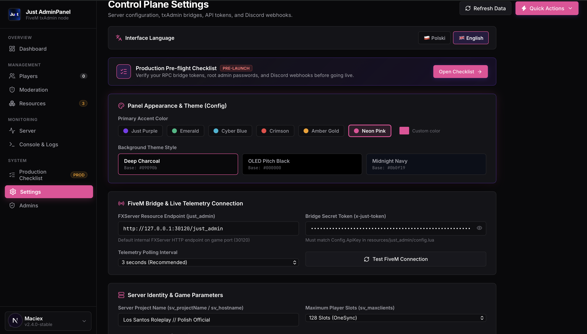

<div align="center">

[🇬🇧 English](README.md) • [🇵🇱 Polski](README_PL.md)

</div>

# Just AdminPanel

A lightweight, modern web control plane for FiveM FXServer. Designed as a sleek, high-performance alternative to traditional panels with zero bloat and instant setup.

Works directly over your native FiveM port (`30120`) via built-in HTTP handlers — no external databases required, no extra open ports needed.

<p align="center">
  
</p>

## Features

* **Real-time Telemetry:** Live server FPS, tick time (ms), RAM usage, CPU load, and network I/O.
* **Connected Players:** Live roster showing ping, framework jobs, cash/bank accounts, and Steam/Discord identifiers.
* **Quick Player Actions:** One-click Kick, Ban, Revive, Heal, and Teleport with native support for ESX, QBCore, and QBox.
* **Custom Bridge:** Modular `bridge.lua` file to hook your own custom server events, SQL ban scripts, or txAdmin actions.
* **Ban Management & Import:** Filterable banlist with instant unban and one-click JSON banlist import.
* **Remote RCON Console:** Fully interactive server terminal running inside your browser.
* **Resource Manager:** Start, stop, and restart FiveM resources without restarting the whole server.
* **Pre-flight Checklist:** Built-in audit checklist to verify API tokens, admin credentials, and Discord webhooks before production deployment.
* **Theme Customization:** Custom accent colors, dark background styles, and multi-language support (PL / EN).

## Screenshots

| Dashboard | Settings & Server Bridge |
|---|---|
|  |  |

## Architecture

The web panel communicates directly with your FXServer instance using the lightweight `just_admin` resource via authenticated HTTP requests on port `30120`.

```
Web Dashboard (Next.js) -> Internal API -> FXServer (:30120) -> just_admin resource
```

## Getting Started

### 1. FiveM Resource Setup

1. Copy the `fivem_resource/just_admin` folder to your server's `resources/` directory.
2. In `resources/just_admin/config.lua`, configure your shared token and panel URL:
```lua
Config = {}
Config.ApiKey = "your-secure-token-here"
Config.PanelUrl = "http://127.0.0.1:3000" -- or port 3001
Config.WebhookSync = true
Config.Framework = "auto"
Config.SyncInterval = 10000
```
3. Add the following to your `server.cfg`:
```cfg
ensure just_admin
```
4. Restart your FXServer or run `refresh` and `start just_admin` in the server console.

### 2. Panel Setup

1. Install dependencies:
```bash
npm install
```
2. Configure `.env.local` with the matching token and endpoint:
```env
FIVEM_ENDPOINT=http://127.0.0.1:30120/just_admin
JUST_API_KEY=your-secure-token-here
```
3. Run the development server or build for production:
```bash
# Development
npm run dev

# Production Build & Start
npm run build
npm start
```

The panel runs by default at `http://localhost:3000` (or `http://localhost:3001`).

* **Default Admin:** `admin`
* **Default Password:** `admin` *(make sure to change it in the Admins tab)*

## Custom Ban & Action Hooks (`bridge.lua`)

Inside `resources/just_admin/bridge.lua`, you can easily route ban, kick, and revive actions through your server's existing systems:

```lua
CustomBridge = {}

function CustomBridge.OnBan(targetId, reason, duration, admin, extra)
    -- Trigger your custom ban event or SQL script:
    -- TriggerEvent('my_framework:ban', targetId, reason, duration, admin, extra)
    DropPlayer(tostring(targetId), ('JustRP [BAN]: %s | By: %s'):format(reason, admin or 'Panel'))
    return true
end
```

## License

MIT
