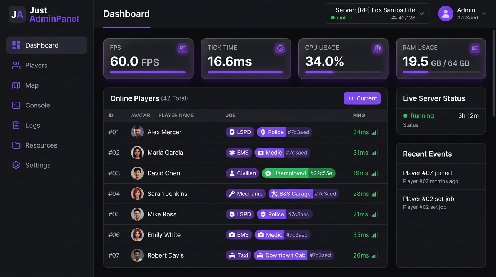
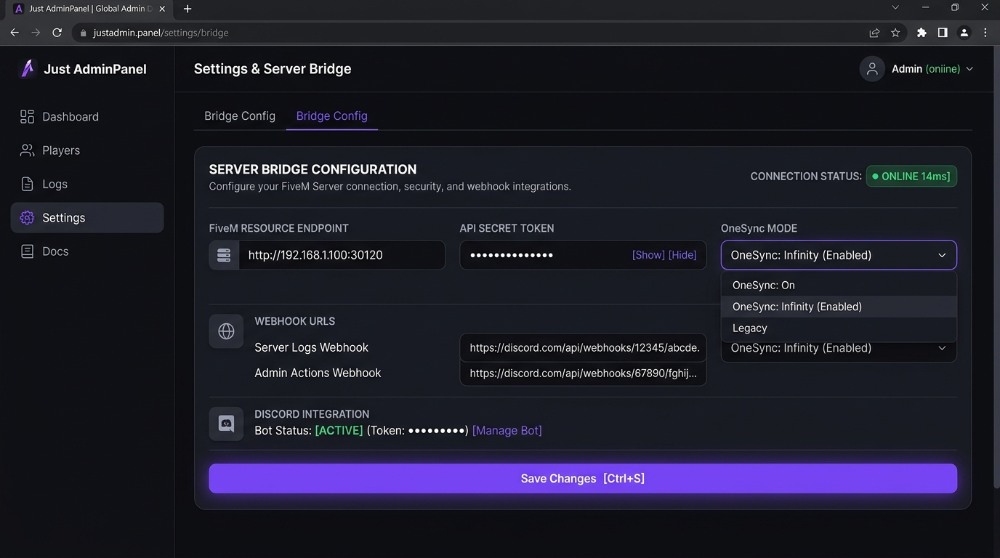

<div align="center">

[🇬🇧 English](README.md) • [🇵🇱 Polski](README_PL.md)

</div>

# Just AdminPanel

A lightweight and modern web administration panel for FiveM servers. A great alternative to txAdmin if you want something clean looking that does not lag your server and works right out of the box.

Runs directly on the default FiveM port (30120) using FXServer built-in HTTP handler so you do not need external databases or extra ports open on your machine.

<p align="center">
  
</p>

## Features

* Real-time server telemetry: live FPS, tick time, CPU and RAM usage
* Online players list with ping, job, wallet and Steam / Discord identifiers
* Quick player moderation actions (kick, ban, revive, heal, teleport) working with ESX and QBCore
* Remote RCON console right in your browser
* Resource manager: start, stop and restart scripts on the fly without rebooting the server
* Active ban list with quick unban
* Settings page to test server connection and configure Discord webhooks
* Built-in authentication screen with session support

## Screenshots

| Dashboard | Settings & Bridge |
|---|---|
|  |  |

## How it works

The web panel talks to FXServer through the lightweight `just_admin` resource. It uses the native `SetHttpHandler` API on port 30120 with token authentication.

```
Web Browser -> Next.js API -> FXServer (port 30120) -> just_admin resource
```

## Quick Start

### 1. FiveM Server Resource

1. Copy the `fivem_resource/just_admin` folder into your server `resources/` directory
2. Open `resources/just_admin/config.lua` and set your secret token:
```lua
Config = {}
Config.ApiKey = "yourtoken"
Config.PanelUrl = "http://localhost:3000"
Config.WebhookEvents = true
```
3. Add to your `server.cfg`:
```cfg
ensure just_admin
```
4. Run `refresh` and `start just_admin` in your server console or reboot the server

### 2. Admin Panel

1. Install dependencies:
```bash
npm install
```
2. Set up your `.env.local` file with the matching token:
```env
FIVEM_ENDPOINT=http://127.0.0.1:30120/just_admin
JUST_API_KEY=yourtoken
```
3. Start the dev server:
```bash
npm run dev
```

Panel runs at `http://localhost:3000`. Default login is `admin` / `admin`.

## In-Panel Configuration

In the Settings tab you can:
* Test live connection to your FiveM server (measures latency in ms)
* Switch between English and Polish language on the fly
* Change telemetry polling frequency (1s up to 10s)
* Connect Discord webhooks for staff audit logs and crash alerts
* Adjust slot limits, OneSync mode and enforced GTA V build
* Export your entire config to a json file

## License

MIT
